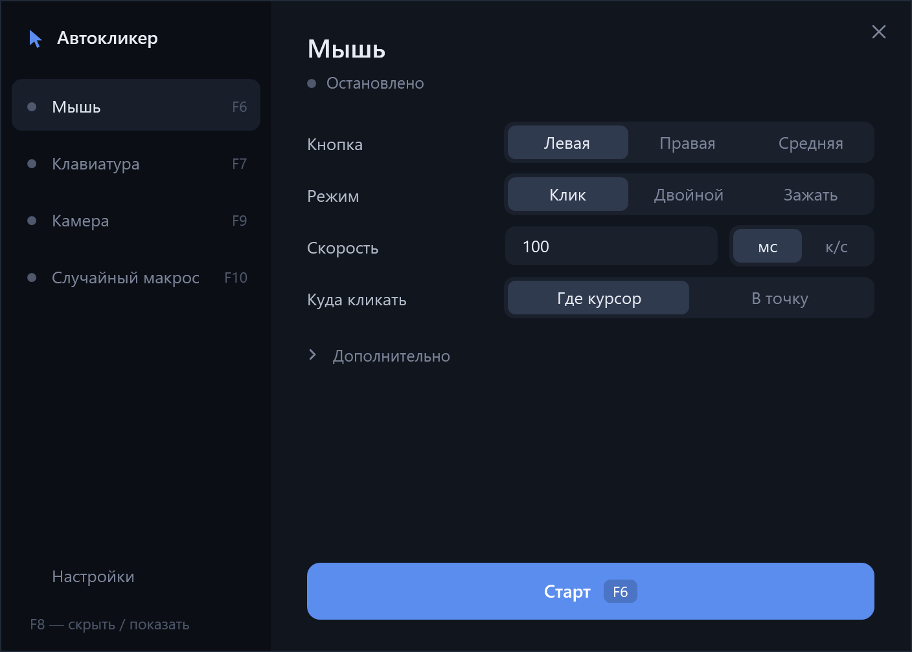
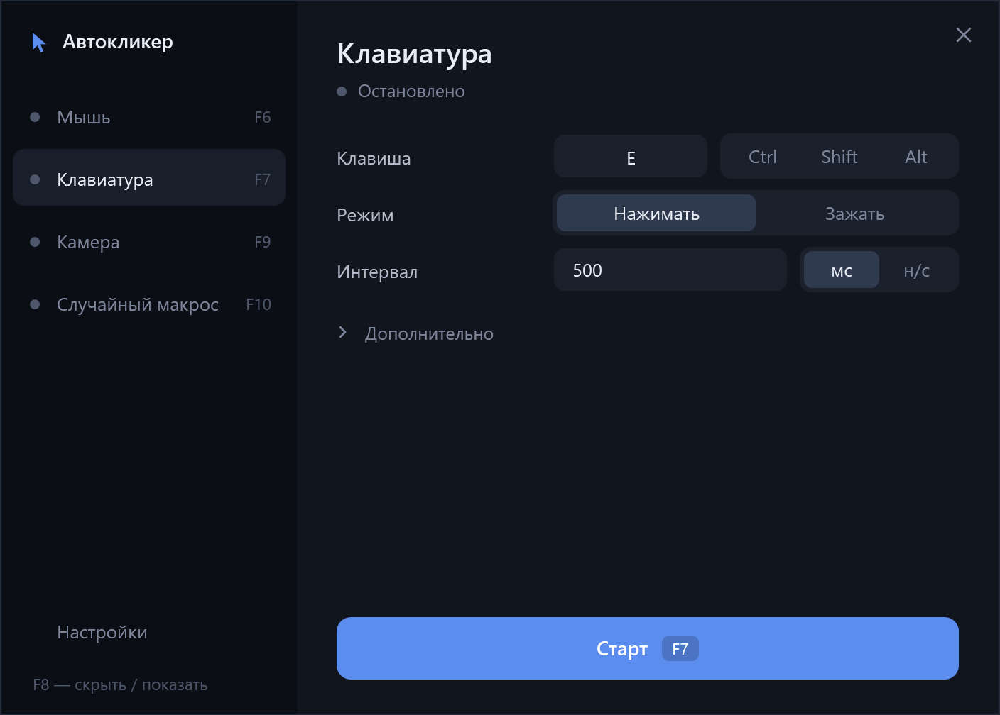
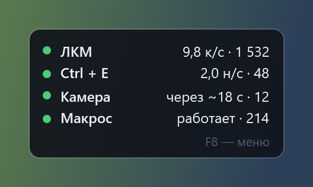

# AutoClicker

Автокликер для Windows: клики мышью, автонажатие клавиш, лёгкое покачивание камеры и случайные движения мыши. Поверх игры висит небольшой оверлей, в котором видно, что сейчас работает.



## Возможности

- **Мышь (F6)**: левая, правая или средняя кнопка; одиночный клик, двойной или зажать. Скорость в мс или кликах в секунду, случайный разброс, длительность нажатия. Можно кликать под курсором или в выбранную точку экрана. Есть задержка старта и лимит кликов.
- **Клавиатура (F7)**: любая клавиша, можно вместе с Ctrl, Shift или Alt. Режимы «нажимать» и «зажать», те же тайминги, что у мыши.
- **Камера (F9)**: раз в полминуты (можно поменять) камера плавно сдвигается и возвращается на место.
- **Случайный макрос (F10)**: мышь плавно ходит к случайным точкам в небольшой области, после остановки возвращается на место.
- **Меню (F8)**: все горячие клавиши можно переназначить.
- **Только в окне игры**: если переключиться на другое окно, всё встаёт на паузу и отпускает зажатые кнопки.
- **Оверлей** в выбранном углу экрана, мышь сквозь него проходит, фокус он не забирает.
- **Значок в трее**: клик открывает меню, правый клик — «Остановить всё» и «Выход».

<p>
  
  
</p>

## Скачать

Готовый `AutoClicker.exe` лежит в [Releases](../../releases/latest). Установка не нужна, это один файл.

Настройки сохраняются в `settings.json` рядом с exe.

## Как устроено

- Нажатия идут через `SendInput`, клавиши отправляются скан-кодами, поэтому их видят и игры на DirectInput или raw input.
- Горячие клавиши работают через `RegisterHotKey`. Клавиатурных хуков нет.
- Оверлей — отдельное окно поверх остальных. В процесс игры ничего не встраивается, память игры не читается.
- Тайминги считаются в отдельном потоке с точностью около 1 мс.

## Важно

- **Правила игры.** Античит не найдёт здесь чит, но Windows помечает такие нажатия как программные, и игра может это заметить. Во многих онлайн-играх макросы запрещены, Fortnite в том числе. Перед использованием проверь правила своей игры.
- Поверх эксклюзивного полноэкранного режима оверлей не виден, нужен оконный или безрамочный режим.
- Если игра запущена от администратора, кликер тоже надо запускать от администратора, иначе Windows не пропустит нажатия.

## Сборка

Нужен .NET 8 SDK.

```
dotnet build src/AutoClicker -c Release
```

Один файл без зависимостей:

```
dotnet publish src/AutoClicker -c Release -r win-x64 --self-contained true -p:PublishSingleFile=true -p:IncludeNativeLibrariesForSelfExtract=true -p:EnableCompressionInSingleFile=true -o publish
```

## Лицензия

MIT
